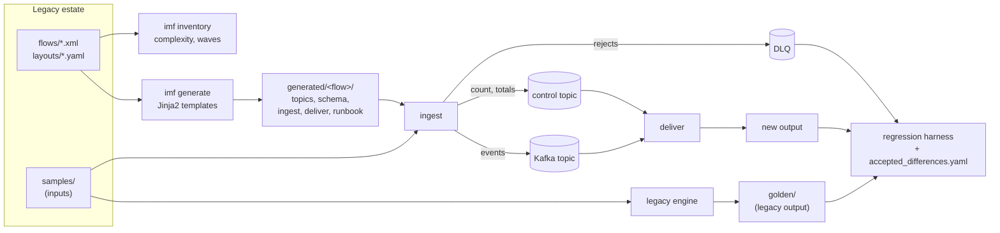

# Integration migration factory

[](https://github.com/darshansatpathy/integration-migration-factory/actions/workflows/ci.yml)
[](https://github.com/darshansatpathy/integration-migration-factory/actions/workflows/codeql.yml)


Moving a few hundred point-to-point integrations off an ESB onto Kafka fails in one of two ways: it is
done by hand, flow by flow, and every team rewrites the mappings slightly differently; or it is done
fast, and the new platform quietly behaves differently from the old one. A date that legacy wrote as a
blank becomes an error, a rounding rule changes, an accented name is upper-cased differently, and the
first anyone hears of it is a reconciliation break in finance.

This repository is the factory approach to that problem, end to end on a representative estate of ten
flows:

1. **Inventory.** Parse every legacy flow definition, score its migration complexity with a published
   formula, and order the estate into dependency-safe waves.
2. **Templated migration.** Generate each flow's Kafka replacement (topics, a JSON Schema for the event,
   an ingest spec, a deliver spec, a cutover runbook) from one set of templates. The runtime reads
   nothing else, and CI fails if the committed artifacts drift from the estate or the templates.
3. **Regression harness.** Run every flow's input through the legacy engine and through Kafka and
   compare the outputs record by record and field by field. Every difference has to be explained by
   an entry in [`accepted_differences.yaml`](accepted_differences.yaml), with an owner, a ticket and a
   limit, or the build fails.

## Results

From [`docs/regression-report.md`](docs/regression-report.md), run against Kafka 4.3:

**10 of 10 flows pass.** 2,358 legacy records compared, 346 differences found, all explained by five
reviewed rules:

| Rule | What the harness found | Records |
|---|---|---|
| AD-001 | Legacy writes a **blank** for a date that does not exist (31 February); the new platform rejects the record to the DLQ | 18 |
| AD-002 | Legacy ships an order with amount **0.00** when the amount field is corrupt; rejected instead | 3 |
| AD-003 | Legacy upper-cases ASCII only: `DANA JOSé PEñA` against `DANA JOSÉ PEÑA` | 24 |
| AD-004 | Legacy computes `gross = net × 1.18` in **binary floating point**: 1031.025 becomes 1031.02, exact decimal gives 1031.03 | 7 |
| AD-005 | Legacy JSON writes every value as a string: `"28"` against `28` | 294 |

The harness also reports what both platforms agree on but should not be forgotten: 11 inventory
descriptions are truncated by the 20-character field of the ERP's fixed-width layout, on either
platform.

What it catches, each pinned by a test that plants the fault ([`tests/test_harness.py`](tests/test_harness.py),
[`tests/test_runtime.py`](tests/test_runtime.py)):

| Planted fault | Caught by |
|---|---|
| Rounding half to even (Python's default) instead of half up | unexplained differences in three flows' prices |
| A mapping that loses a `trim` step | unexplained key and field differences |
| An accepted difference that starts affecting more records | the rule's `max_records` |
| A record lost between ingest and deliver | the batch's control message: the file is not written |
| A record changed in transit | the batch's control totals |
| A retried, duplicated send | dropped by source sequence; the file is unchanged |
| A generated spec edited by hand | `imf generate --check` |

## How it works



- **Ingest** reads the source file (CSV, fixed-width with implied decimals, or XML), applies the
  flow's filter and mapping, validates each event against the generated schema, and publishes it
  keyed by the flow key with its batch id and source sequence in the headers. A record that cannot be
  converted goes to the flow's DLQ with the reason and the original line. Once every record is
  acknowledged, ingest publishes a control message with the batch's count and control totals.
- **Deliver** reads the batch back, drops duplicates by source sequence, refuses to write anything
  unless the count and totals match the control message, and writes the target file in source order.
- **The legacy engine** ([`src/imf/legacy.py`](src/imf/legacy.py)) stands in for the ESB in this
  repository and reproduces its documented quirks. In a real migration the golden files are captured
  from production, and `imf compare` checks a parallel run's shadow output against them.

More in [`docs/architecture.md`](docs/architecture.md) and the decision records in [`docs/adr/`](docs/adr/).

## The estate

[`docs/inventory.md`](docs/inventory.md) is generated from [`estate/`](estate/): ten flows between nine
systems (ERP, WMS, CRM, GL, BI, PIM, POS, SRM, a bank), four migration waves.

| Wave | Flows |
|---|---|
| 1 | SUP-001, INV-001, PRC-001, CUST-001 |
| 2 | INV-002, ORD-001 |
| 3 | ORD-002, INVC-001 (highest complexity: fixed-width, arithmetic, two upstream flows, confidential) |
| 4 | PAY-001, RET-001 |

A flow migrates in the wave after the last flow it depends on, so a downstream flow never runs on
Kafka while its upstream still runs with legacy behaviour.

## Quick start

```bash
python -m venv .venv && . .venv/bin/activate
pip install -e ".[dev]"

imf inventory                    # catalog, scores, waves
imf generate --check             # committed artifacts match the templates
imf regress                      # every flow, with in-memory topics

docker compose up -d             # Kafka 4.3
imf topics                       # create the generated topics
imf regress --bus kafka --report regression-report.md
imf run --flow ORD-001 --bus kafka --input estate/samples/ORD-001/orders.dat --output /tmp/orders.csv
```

Adding a flow: put its XML in `estate/flows/` (and a layout if it is fixed-width), run
`make regenerate`, run `imf regress`, and either fix the mapping or record the difference with its
owner's approval.

## Repository layout

| Path | Contents |
|---|---|
| `estate/flows/`, `estate/layouts/` | The legacy flow definitions and fixed-width layouts |
| `estate/samples/`, `estate/golden/` | Sample inputs with planted edge cases, and the legacy engine's outputs |
| `generated/` | Per-flow topics, schema, ingest and deliver specs, runbook (do not edit) |
| `src/imf/` | Model, transforms, formats, legacy engine, inventory, generator, runtime, harness, CLI |
| `src/imf/templates/` | The Jinja2 templates |
| `accepted_differences.yaml` | Reviewed differences between the platforms |
| `docs/` | Inventory, regression report, architecture, ADRs |

## Limitations

- The legacy platform is emulated; its quirks are the ones a migration typically meets, not a copy
  of any particular product.
- Flows are file-based batch interfaces. Request-reply and streaming interfaces need their own
  templates.
- Deliver reads a batch from the start of the topic, which suits files of thousands of records. For
  very large batches it would resume from committed offsets instead.
- CI runs a single broker; the generated topic specs ask for replication 3 and are capped to the
  broker count when created.

## License

MIT
