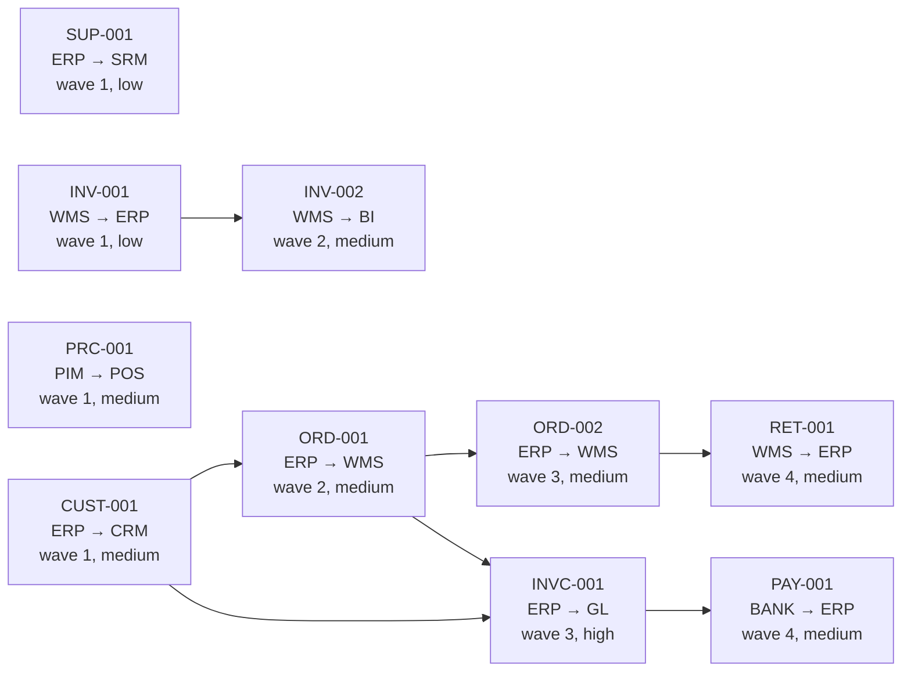

# Interface inventory

10 flows between 9 systems (BANK, BI, CRM, ERP, GL, PIM, POS, SRM, WMS), in 4 migration waves. Generated by `imf inventory` from `estate/`; the scoring is documented in `src/imf/inventory.py`.

| Wave | Flow | Name | Source → target | Formats | Owner | Transforms | Score | Tier | Why |
|---|---|---|---|---|---|---|---|---|---|
| 1 | SUP-001 | Supplier master to procurement | ERP → SRM | csv → jsonl | procurement | 6 | 5 | low | API target |
| 1 | INV-001 | Inventory snapshot to ERP | WMS → ERP | csv → fixed-width | logistics | 5 | 5.5 | low | fixed-width target |
| 1 | PRC-001 | Price list to stores | PIM → POS | xml → csv | merchandising | 5 | 6 | medium | xml source, 1 date conversion |
| 1 | CUST-001 | Customer master to CRM | ERP → CRM | csv → csv | crm-team | 8 | 6.5 | medium | 1 date conversion, confidential |
| 2 | INV-002 | Stock movements to BI | WMS → BI | csv → jsonl | analytics | 9 | 8 | medium | 1 date conversion, 1 upstream, API target |
| 2 | ORD-001 | Daily orders to warehouse | ERP → WMS | fixed-width → csv | sales-ops | 7 | 9 | medium | fixed-width source, 1 date conversion, filter, 1 upstream |
| 3 | ORD-002 | Order lines to warehouse | ERP → WMS | fixed-width → csv | sales-ops | 4 | 7 | medium | fixed-width source, filter, 1 upstream |
| 3 | INVC-001 | Invoices to finance | ERP → GL | fixed-width → csv | finance-systems | 6 | 12.5 | high | fixed-width source, 1 date conversion, arithmetic, filter, 2 upstream, confidential |
| 4 | PAY-001 | Payment confirmations to ERP | BANK → ERP | csv → csv | treasury | 5 | 6 | medium | 1 date conversion, 1 upstream, confidential |
| 4 | RET-001 | Customer returns to ERP | WMS → ERP | csv → csv | customer-service | 7 | 6.5 | medium | filter, 1 upstream |

## Dependencies

## Waves

- **Wave 1** (23 points): SUP-001 (low), INV-001 (low), PRC-001 (medium), CUST-001 (medium)
- **Wave 2** (17 points): INV-002 (medium), ORD-001 (medium)
- **Wave 3** (19.5 points): ORD-002 (medium), INVC-001 (high)
- **Wave 4** (12.5 points): PAY-001 (medium), RET-001 (medium)

## Systems

| System | Sends | Receives |
|---|---|---|
| BANK | PAY-001 | - |
| BI | - | INV-002 |
| CRM | - | CUST-001 |
| ERP | SUP-001, CUST-001, ORD-001, ORD-002, INVC-001 | INV-001, PAY-001, RET-001 |
| GL | - | INVC-001 |
| PIM | PRC-001 | - |
| POS | - | PRC-001 |
| SRM | - | SUP-001 |
| WMS | INV-001, INV-002, RET-001 | ORD-001, ORD-002 |
